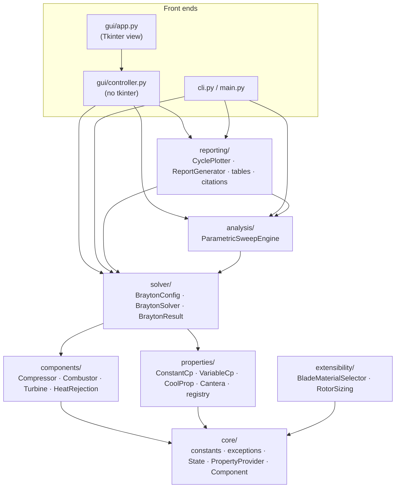

# Architecture

## 1. Module dependencies

Arrows point from a module to what it depends on. Dependencies only ever point downward;
`tests/test_architecture.py::test_layering` enforces this on every test run.



Additional rules on top of the layering:

| Rule | Enforced by |
|---|---|
| Components use only the `PropertyProvider` ABC, never a concrete backend | `test_components.py::test_components_do_not_import_concrete_backends` |
| `gui/app.py` imports only `gui/controller.py` from the package | `test_architecture.py::test_gui_view_talks_only_to_controller` |
| No thermodynamic expressions in `gui/` (no `**`, math functions, or arithmetic on thermodynamic names; no imports of components, properties, constants, numpy or scipy) | `test_architecture.py::test_gui_has_no_thermodynamics` (the scanner is itself tested) |
| Every constant carries a reference tag present in `docs/references.md` | `test_docs.py::test_constant_reference_tag_resolves` |
| Reference data is generated without importing the package | `test_reference_data.py::test_generator_does_not_import_package` |

A single solve proceeds in five steps:

1. `BraytonSolver.solve(config)` gets a backend from the registry.
2. It chains Compressor → Combustor → Turbine → HeatRejection. Each component returns a frozen `ComponentResult`.
3. It audits every component's energy balance, the cycle residual and the mass flow. Each `ComponentResult` has already checked s_gen ≥ 0.
4. It returns a frozen `BraytonResult`.
5. The front ends format that result through `reporting.tables` and plot it through `CyclePlotter`.

## 2. Design patterns

| Pattern | Where | Why |
|---|---|---|
| **Strategy (ABC)** | `core.PropertyProvider` (backends), `core.Component` (cycle components), `extensibility.BladeMaterialSelector`, `extensibility.RotorSizing` | Swap physics models without touching callers; the solver only knows the interfaces. |
| **Factory and registry** | `properties.registry`: `register_provider` and `get_property_provider(name, **options)` | Open/closed: a new backend registers itself. The registry checks options against the constructor signature and reports bad ones as `InputValidationError`. |
| **Data transfer objects** | Frozen dataclasses: `State`, `ComponentResult`, `BraytonConfig`, `BraytonResult`, `OptimumResult`, `MaterialSelection`, `RotorSizingResult`, and the GUI's `RunOutcome`/`SweepOutcome`/`ErrorInfo` | Immutable, hashable-by-value results that are safe to share between CLI, GUI and reports, and trivially serialisable (`to_dict`). |
| **Template method / shared helper** | `components/_turbomachine.adiabatic_process` | Compressor and turbine share the isentropic-state and efficiency logic, with no copy-paste. |
| **MVC** | `gui/app.py` (view), `gui/controller.py` (controller), solver/analysis/reporting (model) | The controller is fully testable without a display. The view has layout and event binding only. |
| **Exception hierarchy** | `core.exceptions` (`BraytonError` → `InputValidationError`, `ConservationError`, …) | Front ends map one hierarchy to exit codes (CLI) or friendly dialogs (GUI). |
| **Lazy import** | Optional backends, `reporting.CyclePlotter`, `gui.launch` | Core use never requires CoolProp, Cantera, matplotlib-at-import or Tk. |

## 3. Worked example: adding a property backend

The goal is a backend for the NASA 7-coefficient polynomial of pure N₂. The steps are the same for any gas.

```python
# my_project/n2_provider.py
import math
from brayton_cycle.core.constants import P_REF, T_REF
from brayton_cycle.core.interfaces import PropertyProvider
from brayton_cycle.properties import register_provider
from brayton_cycle.properties._common import invert_monotonic

@register_provider("nasa-n2")
class NasaN2Provider(PropertyProvider):
    """N2 ideal gas from NASA 7-coefficient polynomials [5] (300-1000 K range only)."""

    name = "nasa-n2"
    _a = (3.53100528, -1.23660988e-4, -5.02999433e-7, 2.43530612e-9, -1.40881235e-12,
          -1.04697628e3, 2.96747038)  # [5] low-T coefficients, verify before use
    _M = 28.0134e-3

    def __init__(self) -> None:
        self._h0, self._s0 = self._h_raw(T_REF), self._s_raw(T_REF)

    @property
    def R(self) -> float:
        return 8.314462618 / self._M

    def _h_raw(self, T: float) -> float:
        a = self._a
        return self.R * T * (a[0] + a[1]*T/2 + a[2]*T**2/3 + a[3]*T**3/4 + a[4]*T**4/5 + a[5]/T)

    def _s_raw(self, T: float) -> float:
        a = self._a
        return self.R * (a[0]*math.log(T) + a[1]*T + a[2]*T**2/2 + a[3]*T**3/3 + a[4]*T**4/4 + a[6])

    def cp(self, T: float) -> float:
        a = self._a
        return self.R * (a[0] + a[1]*T + a[2]*T**2 + a[3]*T**3 + a[4]*T**4)

    def h(self, T: float) -> float:
        return self._h_raw(T) - self._h0

    def s(self, T: float, P: float) -> float:
        return self._s_raw(T) - self._s0 - self.R * math.log(P / P_REF)

    def T_from_h(self, h: float) -> float:
        return invert_monotonic(self.h, h, 200.0, 1000.0, "h [J/kg]", self.name)

    def T_from_s_P(self, s: float, P: float) -> float:
        return invert_monotonic(lambda T: self.s(T, P), s, 200.0, 1000.0, "s [J/(kg K)]", self.name)
```

Use it without changing any solver code:

```python
import my_project.n2_provider  # registers "nasa-n2"
from brayton_cycle.solver import BraytonConfig, BraytonSolver
BraytonSolver().solve(BraytonConfig(T1=300, P1=101325, pressure_ratio=4, T3=950, provider="nasa-n2"))
```

Checklist for a new backend:

1. Implement the six abstract members.
2. Re-reference h and s to (`T_REF`, `P_REF`) so backends are interchangeable.
3. Cite the data source in the class docstring and add it to `docs/references.md`.
4. Add a `PROPERTY_DATA` entry in `reporting/citations.py`, so reports cite it.
5. Add the backend to the `provider` fixture in `tests/test_properties.py`. The generic tests (Mayer relation, dh/dT = cp, round trips, monotonic h) then run against it automatically.

## 4. Worked example: adding a component (intercooler)

A component subclasses `Component`, validates its constructor, uses only the provider ABC, and returns a `ComponentResult`:

```python
from brayton_cycle.components._validation import require_efficiency, require_pressure_loss
from brayton_cycle.core.interfaces import Component, ComponentResult, PropertyProvider
from brayton_cycle.core.state import State

class Intercooler(Component):
    """Cool towards T_cool with effectiveness eps and fractional pressure loss dp."""

    def __init__(self, provider: PropertyProvider, T_cool: float, eps: float, dp: float = 0.0,
                 mass_flow: float = 1.0, *, name: str = "intercooler", outlet_label: str = "1b"):
        super().__init__(provider, name)
        self.T_cool, self.mass_flow, self.outlet_label = T_cool, mass_flow, outlet_label
        self.eps = require_efficiency("eps", eps)
        self.dp = require_pressure_loss("dp", dp)

    def process(self, inlet: State) -> ComponentResult:
        T_out = inlet.T - self.eps * (inlet.T - self.T_cool)
        outlet = self.provider.state(T_out, inlet.P * (1 - self.dp), self.outlet_label)
        q = outlet.h - inlet.h                                  # < 0: heat removed
        return ComponentResult(self.name, inlet, outlet, work=0.0, heat=q,
                               s_gen=(outlet.s - inlet.s) - q / self.T_cool,
                               mass_flow=self.mass_flow)
```

`ComponentResult` rejects s_gen < 0 automatically. To put the intercooler in a cycle, write a
solver variant (or subclass `BraytonSolver`) that inserts it between two compressor stages. The
audits, `BraytonResult`, reporting and GUI need no changes, because they work on the component results.

## 5. Extending the GUI

Add the input to `gui/controller.FIELDS` (key, label, unit, display→SI factor). The view builds
entries from that list automatically. New behaviour goes in a controller method that returns an outcome
dataclass; the view only binds a button to it. `test_architecture.py` fails if any formula slips into `gui/`.
